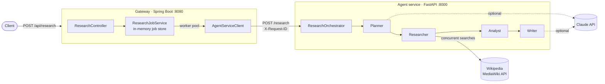

<div align="center">

# 🔬 Multi-Agent Research System

**Ask a question. A team of AI agents plans, searches, analyzes and writes you a cited report.**

[](https://github.com/Prajwal-Pratap-Yadav/multi-agent-research-system/actions/workflows/ci.yml)


[](LICENSE)

[Architecture](#-architecture) · [Quick start](#-quick-start-docker) · [Example output](#-example-output) · [API](#-api-reference) · [Configuration](#-configuration)

</div>

---

## ✨ Highlights

A polyglot, containerized research assistant. You ask a question; a team of
specialized agents plans the research, gathers sources, extracts the evidence and
writes a **cited Markdown report**. Every run has a full execution trace, so you can see
what each agent did and how long it took.

- **Java 21 / Spring Boot 3.4 gateway**: async job API, validation, RFC 9457 errors,
  correlation IDs, structured (ECS JSON) logs, health probes
- **Python 3.11 / FastAPI agent service**: planner → researcher → analyst → writer
  pipeline over a shared context, concurrent search, structured JSON logs
- **Works with or without an LLM**: set `ANTHROPIC_API_KEY` to let Claude plan and
  write the report; leave it empty and deterministic heuristics take over. Findings are
  always grounded in retrieved source sentences, so citations stay traceable.
- **Tested & shipped**: 44 unit/integration tests (96% Python / 91% Java coverage),
  multi-stage non-root Docker images, one-command `docker compose up`, GitHub Actions CI

## 🧩 Architecture



### Request lifecycle

1. `POST /api/research` validates the request and returns **202 Accepted** with a job ID
   and `Location` header. The job runs on a bounded worker pool.
2. The gateway calls the agent service, forwarding the request's `X-Request-ID` so logs
   from both services can be correlated.
3. The **orchestrator** runs the agents in order over a shared `ResearchContext`:

   | Agent | Responsibility | LLM? |
   |---|---|---|
   | **Planner** | Breaks the query into up to 5 focused sub-questions | Optional (template fallback) |
   | **Researcher** | Searches all sub-questions concurrently, de-duplicates sources, tolerates partial failures | No |
   | **Analyst** | Scores every source sentence against each sub-question and keeps the best, cited findings | No (deterministic by design) |
   | **Writer** | Produces a Markdown report with an executive summary, per-question sections and references | Optional (template fallback) |

4. The client polls `GET /api/research/{id}` until `status` is `COMPLETED` or `FAILED`.

### Error handling

| Situation | Behaviour |
|---|---|
| Invalid input | `400` problem detail from the gateway (`422` if calling the agent service directly) |
| Unknown / malformed job ID | `404` / `400` problem detail |
| Some searches fail | Logged and skipped; the report is built from the rest |
| All searches fail | Agent service returns `502`; the job becomes `FAILED` with a clear message |
| LLM error or timeout | Logged; the agent falls back to its heuristic path |
| Unexpected exception | Job marked `FAILED` with a generic message (no internals leaked) |

## 🚀 Quick start (Docker)

```bash
cp .env.example .env          # optionally add ANTHROPIC_API_KEY
docker compose up --build -d
curl http://localhost:8080/actuator/health
```

Submit a question and poll for the result:

```bash
curl -s -X POST http://localhost:8080/api/research \
  -H 'Content-Type: application/json' \
  -d '{"query": "How does quantum computing affect cryptography?", "maxSubQuestions": 3}'
# => {"id":"b96f6f00-...","status":"PENDING", ...}

curl -s http://localhost:8080/api/research/<id> | jq -r .report.report_markdown
```

## 📄 Example output

Trace and report from a real run (heuristic mode, no API key):

```json
"trace": [
  {"agent": "planner",    "duration_ms": 0.02, "summary": "Planned 3 sub-questions"},
  {"agent": "researcher", "duration_ms": 7.5,  "summary": "Collected 2 unique sources (0 failed searches)"},
  {"agent": "analyst",    "duration_ms": 0.15, "summary": "Extracted 5 findings"},
  {"agent": "writer",     "duration_ms": 0.03, "summary": "Wrote report (1081 chars)"}
]
```

```markdown
# How does quantum computing affect cryptography?

## Executive Summary

Quantum computing could break widely used public-key cryptography schemes such as RSA. [1]
Researchers are developing post-quantum cryptography to resist attacks by quantum computers. [1]
A qubit is the basic unit of quantum information in quantum computing. [2]

### How does quantum computing affect cryptography?

- Quantum computing could break widely used public-key cryptography schemes such as RSA. [1]
- Researchers are developing post-quantum cryptography to resist attacks by quantum computers. [1]
- A qubit is the basic unit of quantum information in quantum computing. [2]

## References

1. [Quantum computing](https://en.wikipedia.org/wiki/Quantum_computing)
2. [Qubit](https://en.wikipedia.org/wiki/Qubit)
```

With `ANTHROPIC_API_KEY` set, the planner produces question-specific sub-questions and
the writer turns the same cited findings into flowing prose.

## 📡 API reference

### Gateway (`:8080`)

| Method | Path | Description |
|---|---|---|
| `POST` | `/api/research` | Submit a job. Body: `{"query": string (3-500 chars), "maxSubQuestions": 1-5 (default 3)}` → `202` |
| `GET` | `/api/research/{id}` | Job status and, once completed, the full report |
| `GET` | `/api/research` | All retained jobs, newest first |
| `GET` | `/actuator/health` | Liveness/readiness |

Job `status` is one of `PENDING`, `RUNNING`, `COMPLETED`, `FAILED`.

### Agent service (`:8000`, internal)

| Method | Path | Description |
|---|---|---|
| `POST` | `/research` | Run the pipeline synchronously. Body: `{"query": ..., "max_sub_questions": ...}` |
| `GET` | `/health` | Liveness |
| `GET` | `/docs` | Interactive OpenAPI docs |

## 🔧 Configuration

All variables are optional; see [`.env.example`](.env.example).

| Variable | Default | Used by | Purpose |
|---|---|---|---|
| `ANTHROPIC_API_KEY` | _(empty)_ | agents | Enables Claude-backed planner and writer |
| `ANTHROPIC_MODEL` | `claude-sonnet-5` | agents | Model name |
| `SEARCH_BASE_URL` | Wikipedia API | agents | Any MediaWiki `api.php` endpoint |
| `MAX_SOURCES_PER_QUESTION` | `3` | agents | Search hits per sub-question |
| `HTTP_TIMEOUT_SECONDS` | `15` | agents | Outbound HTTP timeout |
| `LOG_LEVEL` | `INFO` | both | Log verbosity |
| `GATEWAY_PORT` | `8080` | compose | Host port for the gateway |
| `AGENT_SERVICE_READ_TIMEOUT` | `120s` | gateway | Max time to wait for a report |
| `RESEARCH_WORKER_THREADS` | `4` | gateway | Concurrent jobs |
| `RESEARCH_MAX_STORED_JOBS` | `500` | gateway | Jobs retained in memory (oldest evicted) |

## 💻 Local development

**Agent service**

```bash
cd python-service
python -m venv .venv && source .venv/bin/activate
pip install -r requirements-dev.txt
pytest --cov                     # tests + coverage
ruff check . && ruff format --check .
uvicorn app.main:app --reload --port 8000
```

**Gateway**

```bash
cd backend
mvn verify                       # tests + JaCoCo report in target/site/jacoco
AGENT_SERVICE_URL=http://localhost:8000 mvn spring-boot:run
```

## 📁 Project structure

```
.
├── backend/                         Spring Boot gateway
│   └── src/main/java/com/research/gateway/
│       ├── api/                     REST controller, request DTO, exception handler
│       ├── client/                  HTTP client for the agent service
│       ├── config/                  Beans, typed properties, request-ID filter
│       ├── domain/                  ResearchJob, JobStatus, ResearchReport
│       └── service/                 Async job orchestration and storage
├── python-service/                  FastAPI agent service
│   ├── app/
│   │   ├── agents/                  Planner, Researcher, Analyst, Writer
│   │   ├── orchestrator.py          Runs agents and records the trace
│   │   ├── search.py / llm.py       Pluggable search and LLM clients
│   │   └── main.py                  App factory, middleware, error mapping
│   └── tests/
├── docker-compose.yml
└── .github/workflows/ci.yml
```

## 🧭 Design notes and limitations

- **Why two services?** The gateway owns client-facing concerns (job lifecycle,
  validation, backpressure); the Python service owns the agent logic, where the AI
  ecosystem lives. Each scales and deploys independently.
- **Extensibility**: agents share one small `Agent` interface, and search/LLM backends
  are `Protocol`s, so adding e.g. a fact-checker agent or a different search engine
  means one new class plus a line in `build_orchestrator`.
- **Job storage is in memory**: jobs are lost on restart and not shared between gateway
  replicas. A production deployment would back `ResearchJobService` with Redis or
  Postgres.
- **No authentication** is included; put the gateway behind an API gateway or add
  Spring Security before exposing it publicly.

## 📜 License

Released under the [MIT License](LICENSE). Built by **Prajwal Pratap Yadav**.
